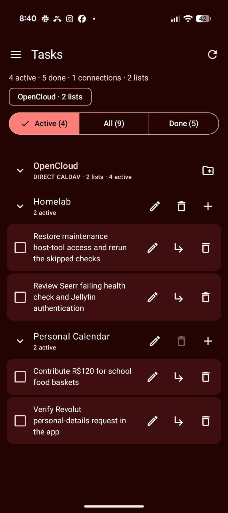

# CalDAV Tasks for Android

Your CalDAV tasks, together. A native Android app with **Material 3**, multiple
accounts, grouped task lists, and a home-screen widget.

Built as the Android companion to
[CalDAV Tasks for Dux Shell (DMS)](https://github.com/brunofin/dms-caldav-tasks),
with the same list-first approach and an Android-native interface. No WebView,
Python runtime, or Evolution dependency.

<p align="center">
  
</p>

## Features

- **All accounts in one view.** Connect multiple CalDAV accounts and see every
  task list together. Overview chips jump to an account without hiding the others.
- **Grouped, collapsible lists.** Fold accounts and individual lists independently.
  Your choices persist without changing task counts or background synchronization.
- **Open tasks first.** Accounts are ordered by their total open tasks; their lists
  are ordered by their own open-task counts. Alphabetical names break ties.
- **Active / All / Done.** Filters and counts span every enabled account.
- **Tasks and subtasks.** Add tasks inline, edit titles, complete/reopen tasks,
  create subtasks, and confirm before permanently deleting anything.
- **List management.** Create, rename, and delete task-only lists. Mixed
  event/task collections are protected from deletion.
- **Native Material 3.** Light/dark themes, wallpaper-derived colors on Android 12+,
  and a hamburger navigation drawer with a separate Settings screen.
- **Home-screen widget.** A resizable, scrolling task list with shared filters,
  collapsible groups, completion controls, and manual refresh.
- **Encrypted local storage.** Credentials and cached tasks are protected with
  Android Keystore-backed encryption.

## Desktop companion: Dux Shell

Use [CalDAV Tasks for Dux Shell (DMS)](https://github.com/brunofin/dms-caldav-tasks)
to get the same grouped, collapsible task-list workflow on your Linux desktop.

Configure the same CalDAV accounts separately in both apps. They work with the
same tasks **through your CalDAV server**—there is no direct phone-to-desktop
connection, separate hosted backend, or automatic credential transfer.

The desktop plugin also supports Evolution/EDS system accounts, including
GOA-backed task sources. **This Android app uses direct CalDAV only.**

## Getting started

Requires **Android 8.0 or newer**. This is currently a development build; no public
release APK or Play Store listing has been published.

1. Build and install the debug APK using the instructions below.
2. Open **☰ → Settings**.
3. Add a connection name, your server's **HTTPS CalDAV URL**, username, and app
   password. Use the final CalDAV endpoint, not a web login page.
4. Save, return to **Tasks**, and refresh. All enabled accounts and lists appear
   together.

For example, an OpenCloud/Radicale endpoint may look like
`https://cloud.example.com/caldav/`. The exact discovery URL depends on your server.
Server-specific OAuth sign-in is not implemented; use an app password where needed.

The app refreshes when opened, manually, and approximately every two minutes while
visible. Background refresh uses Android WorkManager's approximately 15-minute
minimum interval; Doze, battery restrictions, and force-stop can delay it.

### Home-screen widget

Long-press your home screen, open **Widgets**, and add **CalDAV Tasks**.

- Expand/collapse account and list headings, change **Active / All / Done**, and
  complete/reopen tasks without opening the full app.
- Tap **↻** to refresh. A list's **+** opens its inline composer in the app.
- Tap the title or task text to open the app. Editing, subtasks, settings, and
  destructive actions are handled in the full interface.
- All widget instances share the app's filters and folds. There is no per-widget
  account selection.

The widget shows cached task titles to your launcher. Use it only on a trusted
home screen. Widget actions are tested in an Android widget host; actual launcher
layouts and resizing still need broader testing.

## Privacy and calendar safety

- Credentials **and task cache** use device-bound AES-GCM encryption via Android
  Keystore. Writes are atomic; app backup/device transfer are disabled. Disconnecting
  removes local connection data only, never server accounts or tasks.
- HTTPS and normal certificate validation are mandatory. Redirects, cross-origin
  discovery, embedded URL credentials, and query tokens are refused.
- ETag-based conditional writes prevent silently overwriting concurrent edits.
  Failed sources retain cached data and become read-only until refresh succeeds.
- Unknown iCalendar fields, dates, time zones, and alarms survive title/status edits.
  Events are never shown as tasks; mixed collections cannot be deleted.
- No analytics, credential import, custom hosted service, or offline write queue.
  A failed change is not presented as a successful local-only update.

### Current limits

Recurring tasks, recurrence overrides, multi-component resources, and resources
without ETags are read-only. Due-date editing, reminders, OAuth flows, cross-list
moves, and drag reordering are not implemented. Drafts survive folding and activity
recreation, but not process death. Clearing app data or losing the Keystore key
loses local connection setup; server tasks remain on the server.

## Build and install

Requires **JDK 17 or 21**, **Android SDK platform 35**, and compatible Build Tools.
The project pins Gradle **8.11.1**, Android Gradle Plugin **8.9.2**, and Kotlin
**2.1.20**. The official Gradle wrapper includes distribution checksum verification.

Open the project in Android Studio, or configure `JAVA_HOME` and `ANDROID_HOME`:

```sh
./gradlew :app:assembleDebug
"$ANDROID_HOME/platform-tools/adb" install -r app/build/outputs/apk/debug/app-debug.apk
```

The APK is at `app/build/outputs/apk/debug/app-debug.apk`. This is a debug-signed
development APK, not a production release.

If you use Android Studio's local `.gradle/config.properties` JDK setting, the
helper reads it and defaults the SDK location to `~/Android/Sdk`:

```sh
./tools/gradle.sh --max-workers=2 :app:assembleDebug
```

Do not commit `local.properties`, signing keys, account data, or device logs.

## Testing and status

Version **0.1.0**, verified on **2026-10-29**:

- Debug and instrumentation APKs build successfully.
- **28 JVM checks pass:** list ordering/filtering, task trees and cycles, iCalendar
  preservation, Unicode folding, CalDAV discovery, conditional writes, and safety.
- **6 native Waydroid tests pass** on Android 11/API 30, covering navigation,
  folds/counts, draft retention, task creation/completion, encrypted storage, and
  widget collection actions through WorkManager.
- Android lint: **0 errors**, 19 advisory dependency/KTX warnings.
- The maintainer has also installed the app on a physical phone and supplied the
  OpenCloud screenshot above. This is user-reported use, not a full device/server
  compatibility test suite.

```sh
./tools/gradle.sh --max-workers=2 :app:testDebugUnitTest :app:lintDebug
ANDROID_SERIAL=YOUR_DEVICE_SERIAL ./tools/gradle.sh --max-workers=2 :app:connectedDebugAndroidTest
```

Instrumentation uses synthetic accounts, a separate encrypted test store, and
intercepted HTTP responses. It does not access real accounts or alter the user's
home screen. Physical-device coverage, accessibility, modern Android versions,
real launcher behavior, and disposable-server integration still need broader tests.

SDK-free checks are available in `tools/test-core.sh`, `tools/test-dav.sh`, and
`tools/check-resources.py`. See [AGENTS.md](AGENTS.md) for architecture, test setup,
and contributor safety rules.

## License

[MIT](LICENSE) © 2026 Bruno Finger.
